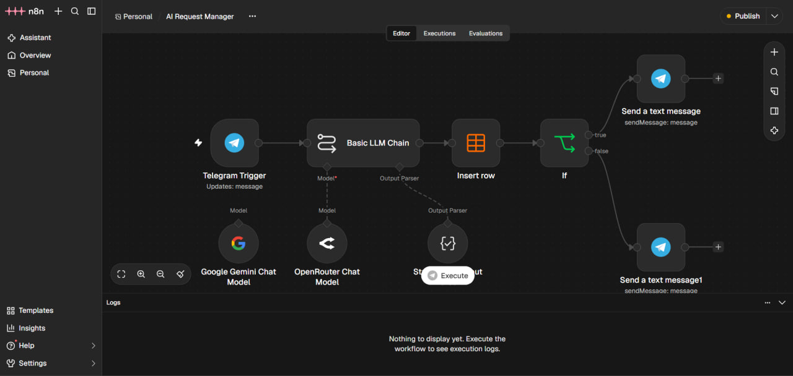
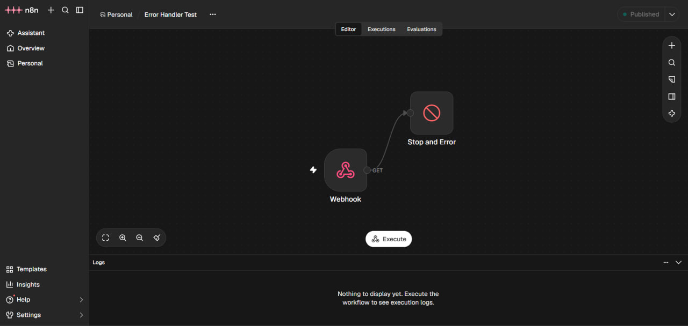
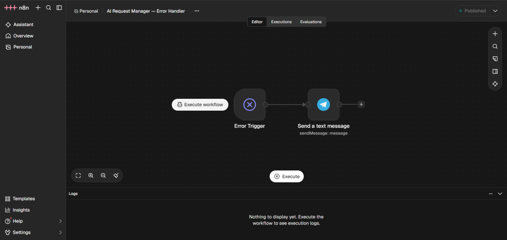
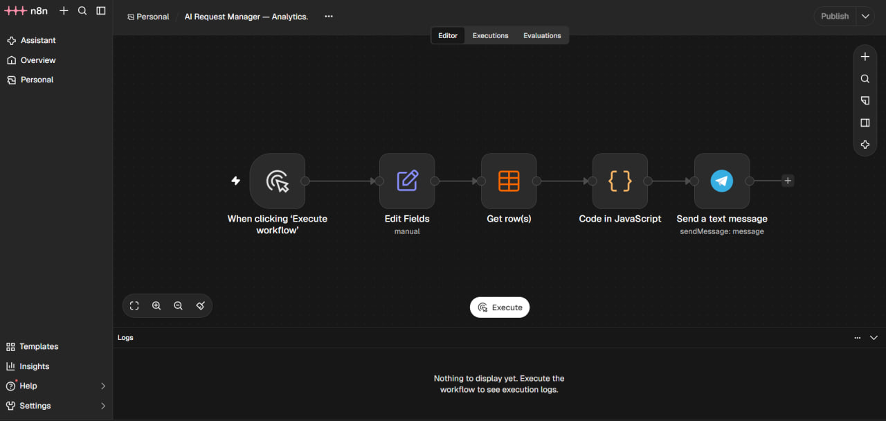

# AI Request Manager

<div align="center">
  
</div>
<p>
  
  
  
  
  
</p>

Учебный проект автоматизации обработки обращений с помощью **n8n, Google Gemini и Telegram**. Workflow принимает текстовые сообщения, классифицирует обращения, сохраняет результаты и направляет уведомления в зависимости от необходимости участия сотрудника.

Проект показывает практическую работу с no-code/low-code автоматизацией, интеграцией внешнего API, структурированным ответом LLM, хранением данных и обработкой ошибок. Это портфолио-проект, а не готовая к промышленной эксплуатации служба поддержки.


## Навигация

- [Возможности](#возможности)
- [Архитектура](#архитектура)
- [Технологии](#технологии)
- [Установка и запуск](#локальный-запуск)


## Демонстрация

[Посмотреть демонстрационное видео](https://drive.google.com/file/d/1UGbDxi80J0YD-6bMpyKEt1oCF3E-IDOM/view?usp=sharing)

## Скриншоты

### Основной процесс обработки обращений

Получение сообщения, AI-классификация, сохранение результата и маршрутизация обращения.



### Обработка ошибок

Отдельный workflow получает события ошибок и отправляет уведомление в Telegram.



### Дополнительный обработчик ошибок



### Аналитика

Ручной запуск отчёта по обращениям, сохранённым в Data Table.



## Возможности

- Приём текстовых обращений через Telegram-бота.
- Классификация сообщений с помощью Google Gemini.
- Определение категории, приоритета и эмоциональной окраски.
- Формирование краткого описания проблемы и определение ответственного отдела.
- Определение необходимости участия сотрудника.
- Сохранение исходного сообщения и результата классификации в n8n Data Tables.
- Уведомление сотрудника для обращений, требующих вмешательства.
- Автоматический ответ пользователю в остальных случаях.
- Отдельный workflow для уведомлений об ошибках.
- Ручное формирование статистики по сохранённым обращениям.

## Архитектура

В репозитории находятся три экспортированных workflow:

| Файл | Назначение | Запуск |
|---|---|---|
| `main-workflow.json` | Приём и классификация обращений, запись в таблицу, маршрутизация | Telegram Trigger |
| `error-handler.json` | Уведомление о сбоях выполнения | Вызывается как Error Workflow |
| `analytics-workflow.json` | Подсчёт статистики по обращениям и отправка отчёта | Вручную из n8n |

### Основной workflow

1. Telegram Trigger получает текстовое сообщение.
2. Basic LLM Chain передаёт текст модели через узел **Google Gemini Chat Model**.
3. Structured Output Parser ограничивает ответ заданной JSON-структурой.
4. Data Table сохраняет обращение и результат анализа.
5. IF проверяет поле `requires_human`.
6. При значении `true` сотруднику отправляется уведомление с классификацией и исходным сообщением.
7. В остальных случаях пользователю отправляется подтверждение о получении обращения.

**Интеграция модели:** в текущем экспорте используется узел n8n Google Gemini Chat Model с учётными данными Google Gemini API. OpenRouter в текущем JSON workflow не используется.

### Поля классификации

| Поле | Возможные значения / назначение |
|---|---|
| `category` | `technical_support`, `payment`, `account`, `delivery`, `other` |
| `priority` | `low`, `medium`, `high`, `critical` |
| `sentiment` | `positive`, `neutral`, `negative` |
| `summary` | Краткое описание проблемы на русском языке |
| `department` | `technical_support`, `finance`, `customer_support`, `logistics` |
| `requires_human` | `true` или `false` |

Правила промпта отдельно учитывают обращения по входу в аккаунт, подозрения на мошенничество, несанкционированные списания и критические ошибки. Негативная эмоциональная окраска сама по себе не является основанием для передачи обращения сотруднику.

### Хранение данных

Основной и аналитический workflow используют одну Data Table с именем `support_requests`. Для самостоятельного развёртывания создайте таблицу со следующими полями:

| Колонка | Тип |
|---|---|
| `message_text` | String |
| `category` | String |
| `priority` | String |
| `sentiment` | String |
| `summary` | String |
| `department` | String |
| `requires_human` | Boolean |
| `telegram_chat_id` | String |
| `created_at` | DateTime |

### Аналитика

Workflow получает записи из `support_requests`, рассчитывает общее количество обращений, распределение по категориям и приоритетам, а также количество обращений с необходимостью участия сотрудника.

Период задаётся в узле **Edit Fields** через поле `period`:
- `7` — последние 7 дней;
- `30` — последние 30 дней;
- `all` — все сохранённые обращения.

В опубликованном JSON по умолчанию установлено значение `all`. Чтобы изменить период, откройте узел Edit Fields и поменяйте значение вручную. Workflow запускается вручную и по умолчанию не активирован.

## Технологии

| Технология | Использование |
|---|---|
| n8n | Оркестрация workflow |
| Google Gemini API | Анализ и классификация текста |
| Telegram Bot API | Получение сообщений и отправка уведомлений |
| n8n Data Tables | Хранение обращений |
| JavaScript | Подсчёт аналитических показателей |
| Docker Compose | Локальный запуск n8n |
| Cloudflare Tunnel | Внешний HTTPS-адрес для Telegram webhook при локальном тестировании |
| GitHub Actions | Автоматическая проверка JSON-файлов workflow |

## Локальный запуск

### 1. Запустите n8n

Потребуется Docker Desktop. Склонируйте репозиторий и запустите контейнер:

```bash
git clone https://github.com/sk8teJ/ai-request-manager.git
cd ai-request-manager
docker compose up -d
```

Откройте n8n: [http://localhost:5678](http://localhost:5678).

При первом запуске завершите первоначальную настройку пользователя n8n.

### 2. Настройте внешний адрес для Telegram

Telegram Trigger должен быть доступен по HTTPS. Для локального тестирования можно использовать Cloudflare Tunnel.

В `compose.yaml` замените `YOUR-CLOUDFLARE-TUNNEL-URL` в переменной `WEBHOOK_URL` на выданный HTTPS-адрес, затем перезапустите контейнер:

```bash
docker compose up -d
```

### 3. Создайте Data Table

В n8n создайте таблицу `support_requests` и добавьте колонки из таблицы выше. После импорта workflow заново выберите эту таблицу в узлах **Insert row** основного процесса и **Get row(s)** аналитического процесса: идентификатор Data Table из экспортированного файла относится к исходному экземпляру n8n.

### 4. Импортируйте workflow

Импортируйте JSON-файлы в n8n:
1. `error-handler.json`;
2. `main-workflow.json`;
3. `analytics-workflow.json`.

После импорта откройте настройки основного workflow и укажите импортированный **AI Request Manager — Error Handler** в качестве Error Workflow. Это связывает основной процесс с отдельным обработчиком ошибок.

### 5. Подключите учётные данные

В соответствующих узлах выберите собственные credentials:
- Telegram Bot — в Telegram Trigger и узлах отправки сообщений;
- Google Gemini API — в Google Gemini Chat Model.

Идентификаторы credentials из экспортированного файла относятся к исходному экземпляру n8n. На новой установке необходимо выбрать или создать свои учётные данные.

### 6. Укажите Telegram Chat ID

В узлах отправки уведомлений workflow `error-handler.json` и `analytics-workflow.json` замените `YOUR_TELEGRAM_CHAT_ID` на ID чата, в который должны приходить сообщения об ошибках и аналитические отчёты.

В основном workflow Chat ID пользователя берётся непосредственно из входящего Telegram-сообщения.

### 7. Проверьте процессы

- Активируйте Error Handler и основной workflow.
- Отправьте боту тестовое текстовое сообщение.
- Проверьте, что запись появилась в `support_requests`.
- Проверьте соответствующую ветку маршрутизации и уведомления.
- Запустите Analytics вручную через **Execute workflow**.

Для аналитики и обработчика ошибок должны быть настроены собственные Telegram credentials и Chat ID.

## Безопасность

- Не добавляйте в репозиторий API-ключи, Telegram-токены, пароли и файлы с реальными данными пользователей.
- Используйте credentials n8n для хранения секретов.
- Не публикуйте реальные обращения пользователей и персональные данные в скриншотах или тестовых данных.
- Для постоянного или публичного развёртывания используйте закреплённую версию Docker-образа n8n вместо плавающего тега `latest` и отдельно настройте доступ к экземпляру.

## Проверка файлов workflow

JSON-файлы проверяются скриптом без сторонних зависимостей:

```bash
node scripts/validate-workflows.mjs
```

Проверяются корректность JSON, структура workflow, уникальность ID и имён узлов, ссылки в connections и связь основного процесса с Error Handler. GitHub Actions запускает эту проверку при push и pull request.

## Статус проекта

Проект содержит экспортированные workflow для классификации обращений, маршрутизации, уведомлений об ошибках и аналитики. В README описана конфигурация, необходимая для импорта в отдельный экземпляр n8n.

Это учебный проект для практики автоматизации бизнес-процессов, интеграции внешних сервисов и применения LLM. Перед использованием в реальной службе поддержки потребуется отдельное тестирование качества классификации, обработка нестандартных типов Telegram-сообщений, контроль доступа и настройка эксплуатационного мониторинга.
